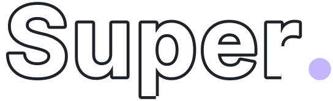

<p align="center">
  <picture>
    <source media="(prefers-color-scheme: dark)" srcset="../../assets/logo-dark.svg" />
    
  </picture>
</p>

# Extension Zed des fichiers `.super`

Déclare le langage « Super » (fichiers `.super`) et lance son serveur de langage
(`packages/lang-server`) : erreurs, complétion, survol, définition, formatage.

Les `.super` ont leur propre langage : vtsls (le serveur TypeScript de Zed) ne les voit plus, et
aucun chemin absolu n'est nécessaire (le serveur est cherché dans le projet ouvert, Node dans son
PATH).

## Installer

1. Rust, par rustup (Zed compile l'extension avec) :

   ```sh
   curl --proto '=https' --tlsv1.2 -sSf https://sh.rustup.rs | sh
   ```

   Puis redémarre Zed pour qu'il trouve `cargo`.

2. Dans Zed : palette de commandes, `zed: install dev extension`, puis choisis ce dossier
   (`editors/zed`). Zed compile l'extension et la grammaire (la première fois, compter une minute).

3. Un `.super` ouvert affiche « Super » en bas à droite de Zed. Après une modification de
   l'extension : *Rebuild* dans le panneau des extensions.

## Ce qui reste à faire

- **Grammaire** : `editors/tree-sitter-super`, compilée par Zed depuis ce dépôt git local (chemin
  absolu dans `extension.toml`, à remplacer par l'adresse du dépôt une fois publié). Après une
  modification de la grammaire : commiter là-bas, mettre à jour `rev`, puis *Rebuild*.
- **« Aller à la définition » depuis un `.ts`** vers un composant `.super` ne demande rien à
  l'extension : vtsls suit la source map de la déclaration du composant (`.super/types/`).

## Réglages

Le binaire du serveur peut être imposé, comme pour tout serveur de Zed :

```json
{ "lsp": { "super-language-server": { "binary": { "path": "node", "arguments": ["…/server.ts", "--stdio"] } } } }
```
